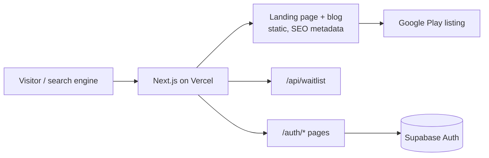

# CertForge Site

Marketing site and SEO blog for **CertForge**, an Android exam-prep app for the AWS Certified Cloud Practitioner (CLF-C02) exam.

[](https://play.google.com/store/apps/details?id=com.getcertforge.app)


[](LICENSE)

Live: https://getcertforge.app · App: [CertForge on Google Play](https://play.google.com/store/apps/details?id=com.getcertforge.app)

## Features

- **Conversion-focused landing page**: every primary CTA leads to the Play Store install.
- **SEO blog**: 5 long-form CLF-C02 guides (study guide, exam tips, practice questions, cost and format, CLF-C02 vs SAA).
- **Structured data**: JSON-LD (app, FAQ, articles) rendered server-side, plus Open Graph and Twitter cards.
- **Dynamic `robots.txt` and `sitemap.xml`** generated from the blog index.
- **Supabase auth pages**: email callback and password reset for the mobile app's accounts.
- **Waitlist endpoint** (`/api/waitlist`) for pre-launch email capture.
- **Privacy policy and terms** required by the Play listing.
- **One config file** (`src/app/_config/site.ts`) holds the Play URL, site URL, launch flag and every price shown on the site.

## Tech stack

| Layer     | Choice                                         |
| --------- | ---------------------------------------------- |
| Framework | Next.js 16 (App Router, Turbopack), React 19   |
| Language  | TypeScript (strict)                            |
| Styling   | Tailwind CSS v4 with CSS-variable brand tokens |
| Auth      | Supabase (`@supabase/supabase-js`)             |
| Hosting   | Vercel                                         |

## Architecture



Pages are statically rendered. Blog posts are TSX modules in `src/app/blog/_content/`, registered in `src/app/_data/blog.ts`, and served by the dynamic `blog/[slug]` route.

## Getting started

Prerequisites: Node.js 20+ and npm.

```bash
git clone https://github.com/realtahailyas/certforge-site.git
cd certforge-site
npm install
cp .env.example .env.local   # fill in your Supabase URL and anon key
npm run dev                  # http://localhost:3000
```

| Variable                        | Purpose                                 |
| ------------------------------- | --------------------------------------- |
| `NEXT_PUBLIC_SUPABASE_URL`      | Supabase project URL (auth pages)       |
| `NEXT_PUBLIC_SUPABASE_ANON_KEY` | Supabase public anon key (auth pages)   |

Other scripts: `npm run build`, `npm start`, `npm run lint`.

## Project structure

```
src/
  app/
    _components/   Nav, Footer, FAQ, PlayStoreButton, WaitlistForm
    _config/       site.ts: Play URL, site URL, launch flag, pricing
    _data/         blog index and FAQ content
    api/waitlist/  POST endpoint for email signups
    auth/          Supabase callback and password reset
    blog/          blog index, [slug] route, post content
    privacy/ terms/
    robots.ts sitemap.ts layout.tsx page.tsx
  lib/supabase.ts  browser Supabase client
public/brand/      wordmark
```

## Status

Live and deployed on Vercel. Planned: wire the waitlist endpoint to an email provider (it currently only logs and acknowledges), and add more CLF-C02 posts.

## License

[MIT](LICENSE) © 2026 Taha Ilyas

## Author

Built by [Taha Ilyas](https://github.com/realtahailyas) · Optivio Automation
